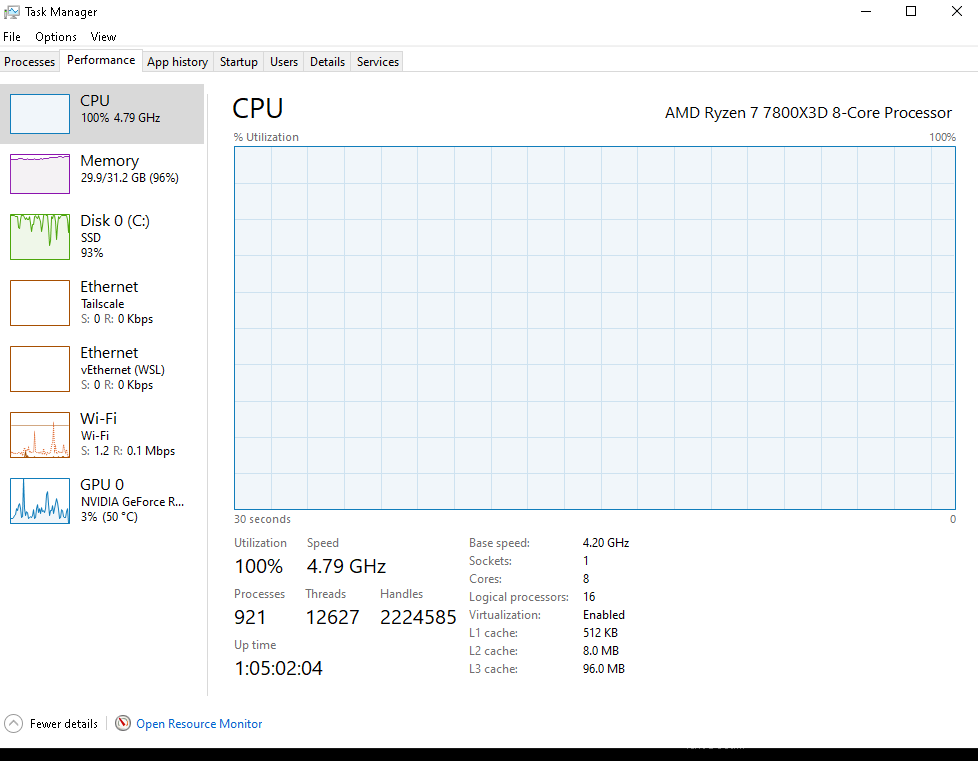
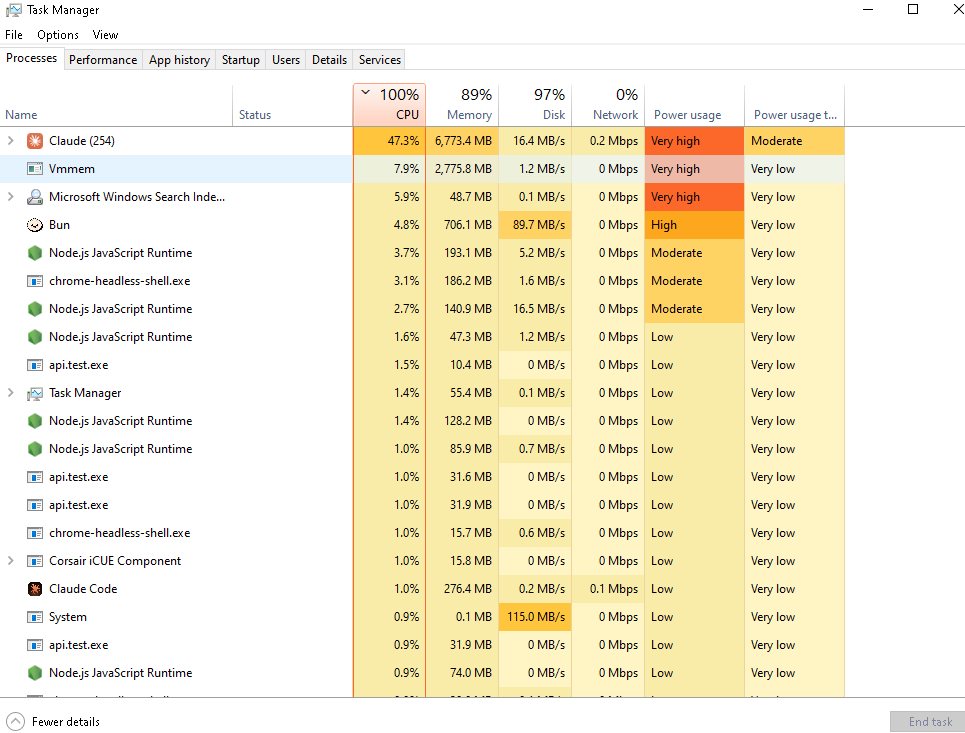

# claude-overclock ⚡

**Your Windows PC is at 100 % CPU, 100 % disk, RAM full and Task Manager shows millions of handles while Claude Code runs?**
`overclock` names the session, agent, process or driver responsible, and frees the machine without stopping your work.

A Claude Code plugin with slash commands, and a single PowerShell file you can also run on its own.



*My PC after 29 hours: CPU 100 %, RAM 96 %, disk 93 %, 921 processes and **2.2 million handles** (normal is 100-300k).*

## Install

**As a Claude Code plugin** (in any Claude Code session):

```
/plugin marketplace add marloncodess/claude-overclock
/plugin install overclock@overclock
```

Then ask Claude "why is my PC so slow?" or use the commands directly: `/overclock:check`, `/overclock:disk`, `/overclock:throttle`, ...

**Let it run on its own:** `/overclock:autopilot install`. Every 10 minutes it ends orphaned Claude process trees and keeps Claude sessions at below-normal priority, so your PC stays usable while agents work. No admin needed, every action is logged, `/overclock:autopilot remove` turns it off.

**Standalone:** download `overclock.ps1` and `known-issues.json` (or clone the repo) and run in PowerShell:

```powershell
powershell -ExecutionPolicy Bypass -File .\overclock.ps1
```

Run it as administrator for everything; `check`, `disk`, `sessions`, `agents`, `leaks`, `reap` and `throttle` also work without.

## Commands

| Slash command | PowerShell | What it does | Changes anything? |
|---|---|---|---|
| `/overclock:check` | `check` | 20-second health check: CPU, RAM, disk I/O and handles **by owner** (each Claude session with everything it started), sessions, MCP copies, agents, orphans, leaks, disk errors | no |
| `/overclock:disk` | `disk` | SSD model, health, temperature, DRAM cache, file system errors, TRIM, maintenance, page file, I/O by session, **what fills the disk** (Docker, Go/npm caches, worktrees, transcripts) | no |
| `/overclock:fix` | `disk repair` | schedules the file system repair, turns maintenance back on, rebuilds broken performance counters, runs TRIM (only on a clean file system). `-DryRun` shows the plan | yes, asks per step (admin) |
| `/overclock:throttle` | `throttle` | every Claude session and everything it started runs at **below-normal CPU priority and background disk priority**: your apps come first, agents keep working on the spare CPU and disk time. `-Undo` reverts | priority only |
| `/overclock:autopilot` | `autopilot install\|status\|remove` | scheduled task for your user: every 10 min ends orphaned trees older than 30 min **that it saw inside a Claude session before** and keeps Claude at below-normal CPU and background disk priority | yes (no admin) |
| `/overclock:reap` | `reap` / `orphans` | dev servers, test runs and headless browsers whose session is gone. `-Kill` ends them (skips anything younger than 10 min); the slash command does this right away | with `-Kill` |
| `/overclock:sessions` | `sessions` | every session: model, project, processes, memory, MCP servers, dev servers with ports, tests, browsers, agents started by your own code | no |
| `/overclock:agents` | `agents -Hours 24` | subagents and workflows per hour from the session logs, peak concurrency, who spawned them | no |
| `/overclock:leaks` | `leaks` | 60-second handle sample, every process whose handles keep growing, with its service | no |
| | `handles <name\|pid>` | one process's handles by object type (Event, File, Process, ...) | no (admin) |
| `/overclock:spawns` | `spawns` | every process start for 60 s, grouped by the session that caused it | no (admin) |
| `/overclock:watchdog` | `watchdog install\|status\|remove` | scheduled task (SYSTEM) that restarts a leaking service above `-Threshold` handles, with a heartbeat so a deleted task shows up | install/remove (admin) |
| `/overclock:report` | `report` | `overclock-report.md` for an issue, without user names, paths or project names | no |

One PowerShell 5.1 file, no dependencies, Windows 10 and 11.

## What actually took my PC down

I expected one bug. It was a pile-up. All numbers are from my PC (Ryzen 7 7800X3D, 32 GB, Kingston NV2 1 TB, Windows 10 22H2), measured with the commands above.

### 1. Too much parallel work: 13 sessions at once

```
/overclock:check
 14.4 %    70 proc  Claude session f868a144 ~\my-app [worktree] e2e-pq-plan
 10.6 %     1 proc  vmmem
  5.6 %    13 proc  Claude session fef1eda9 ~\my-app [worktree] scheduled-tasks
...
Sessions running: 20   agents started by your code: 12
```

**13 sessions worked at the same time**, most of them started as side sessions by one lead session: e2e tests, a second GitHub app, security reviews, landing page, mockups, CI. Each builds, tests, starts Docker databases or its own agents. One of them ran workflows with **24 agents** (8 at once, peak 14), each in its own copy of the repo; in 47 minutes they ran 1,120 shell commands. One e2e test started **12 real Claude agents** of its own.

After a reboot, the desktop app **resumes every open session**, and the heaviest one started its next 22-agent workflow 3 minutes after the PC was back up. Rebooting does not help.

**Fix without stopping anything:** `/overclock:throttle` set 286 Claude processes to below-normal priority. Builds and agents keep running, Windows serves your own apps first, and new processes inherit the lower priority. **Real fix:** fewer sessions and agents at once.



### 2. The disk: full RAM, a cache-less SSD and a file system nobody repaired

```
/overclock:disk
KINGSTON SNV2S1000G  NVMe SSD, 932 GB, Healthy  38 °C now, max 83 °C  (no DRAM cache)
  C:    183.5 GB free of 820 GB (22%)   FILE SYSTEM ERRORS   no TRIM in 120 days
Automatic maintenance: OFF   performance counters: BROKEN
Page file: 8,578 MB in use (peak 13,476 MB since boot)
```

- **RAM at 94 %** made Windows page to the SSD (8.5 GB in use, 13.5 GB peak). That alone keeps "disk 100 %" in Task Manager while only ~30 MB/s flow.
- The **Kingston NV2 has no DRAM cache**. Thousands of small parallel writes (git, `node_modules`, builds in 36 worktrees) are its worst case. It also reached **83 °C**, where NVMe drives throttle.
- **C: has file system errors since 8 Nov**: NTFS asked for a scan at every boot (11 times), the dirty bit is set. It started the night C: was shrunk to make room for a Linux dual boot.
- Nothing ever repaired it, because **Windows automatic maintenance was switched off**. That also means **no TRIM in 120 days**, which makes an SSD slower and slower.
- The online scan (`chkdsk /scan`) could not even run: **there is no shadow copy storage** on any drive.
- **Windows performance counters were broken**, so no monitoring tool except Task Manager could see the disk load.

**Without a restart:** `/overclock:throttle` also puts every Claude process, including plugin databases like claude-mem's vector store (here 21 MB/s of reads), at **background disk priority**, so Windows serves your own reads and writes first. On my PC the disk traffic dropped from about 75 to 26 MB/s.

**Fix:** `/overclock:fix` schedules `chkdsk /spotfix` (about a minute at the next restart), turns maintenance back on and rebuilds the counters. **TRIM runs only after the file system is repaired**: TRIM on a damaged file system can release blocks that are still in use.

### 3. A Bluetooth driver leaking Event handles (the 2 million handles)

`mtkbtsvc.exe`, the service of the **MediaTek RZ608** Wi-Fi/Bluetooth adapter (driver 1.1044.0.556), held **464,317 handles**, three quarters of all handles on the PC.

```
overclock handles mtkbtsvc
== mtkbtsvc (pid 22444): 96,088 handles
    96,002   99.9 %  Event
```

It grows in bursts, up to **760,000 handles per hour**, and has nothing to do with Claude Code: during 439 extra process starts it gained 0 handles. **Fix:** a newer Bluetooth driver. **Until then:** `overclock watchdog install mtkbtsvc`.

> My first watchdog task **disappeared shortly after I created it**, and I only noticed a day later when the handles were back at 2 million. That is why the watchdog writes a heartbeat and `check` reports `TASK MISSING` or `STALE`.

### 4. 9,000 process starts per minute

`overclock spawns`: 3,026 process starts in 20 s, 2,051 of them `git.exe`, from tests that create throw-away repos plus every tool call (shell, `conhost`, each hook). If RAM also disappears without an owner, a driver may keep those processes in kernel memory: see [claude-code-zombies](https://github.com/marloncodess/claude-code-zombies). Not the case here (`zombieprobe`: 0 of 49).

### 5. Every session runs every MCP server

User-level MCP servers start **once per session**: 20 sessions x 3 servers = 60 extra processes, several GB. `check` flags any server that runs once per session.

### 6. A plugin hook on every tool call

`claude-mem` hooks into every `PostToolUse`. At the peak its log grew by 2,526 lines in 10 minutes while it was rate-limited 6,583 times, so its queue only grew; its vector database alone used 2.8 GB of RAM.

### 7. Orphaned dev servers and test runs

Trees whose session or shell is gone: duplicated `npm run dev` servers from hours ago, hanging `vitest`, a Go fuzzer, 4 headless Chromes. `reap -Kill` freed 60 processes and 26,000 handles the first time; a day later there were 7 GB of them again. Claude Code's own timeouts and `TaskStop` clean up correctly (tested); where these come from is still open. Found out? Please open an issue.

## What to do, in order

1. `/overclock:check` - read the findings.
2. `/overclock:throttle` - your PC is usable again right away, nothing is stopped. `/overclock:autopilot install` keeps it that way.
3. **Run fewer sessions and agents at once.** Archive sessions you don't use: the desktop app resumes all of them after a restart. Cap parallel agents in workflows (3-4).
4. `/overclock:fix` - repair the file system, maintenance, counters; after the restart run it again for TRIM.
5. `/overclock:reap` - end leftover dev servers and test runs.
6. Move MCP servers you need only in some projects into those projects' `.mcp.json`. Check hooks in `~/.claude/settings.json` and plugins.
7. `/overclock:leaks` - a leaking driver needs an update; `watchdog install` bridges the time.
8. Cap WSL/Docker memory with `memory=8GB` in `%UserProfile%\.wslconfig`. Give the SSD a heatsink if `disk` shows 70 °C+.

## Safety

- Read-only: `check`, `disk`, `sessions`, `agents`, `leaks`, `handles`, `spawns`, `reap`, `watchdog status`, `report`, `disk repair -DryRun`.
- `throttle` only changes CPU and disk (I/O) priority and is undone with `-Undo`.
- `reap -Kill` never touches trees younger than `-MinAgeMinutes` (default 10) or background services. In a terminal it asks per tree; `/overclock:reap` runs it right away.
- `autopilot` only ends a tree if it saw one of its processes inside a Claude session on an earlier run. A server you started yourself and detached is never touched, even when its parent is gone (tested). It runs invisibly through `wscript`, logs every action to `%LOCALAPPDATA%\claude-overclock\autopilot.log`, and `check` reports it as `STALE` or `TASK MISSING` if it stops.
- The `System` process and other kernel processes never get a watchdog recommendation.
- `disk repair` asks before every step, never runs TRIM on a damaged file system, and the file system repair itself runs at the next restart.
- `watchdog install` refuses a process that hosts several services (like `svchost`).
- The slash commands tell Claude to show what will change and wait for your yes before anything that changes your system. Claude never stops or archives your sessions on its own.
- `report` replaces user name, PC name and paths and calls projects `project-A`, `project-B`; it does list MCP server names.

## Known issues

| What | Device / driver | Problem | Fix |
|---|---|---|---|
| `mtkbtsvc.exe` | MediaTek RZ608 Bluetooth, 1.1044.0.556 | Event handles, up to 760k/h | update the driver; `watchdog install mtkbtsvc` |
| SSDs without DRAM cache | Kingston NV1/NV2/NV3, Crucial P2/P3, WD Blue SN5x0, Samsung 980, ... | slow under many small parallel writes | fewer parallel agents/worktrees; a DRAM SSD for heavy agent work |

`check`, `leaks` and `disk` look up [`known-issues.json`](known-issues.json). **Found a new one?** Run `/overclock:report` and open an issue.

## Related

- [claude-code-zombies](https://github.com/marloncodess/claude-code-zombies): RAM fills up but no process owns it? A driver may keep every exited process in kernel memory.

## License

MIT
